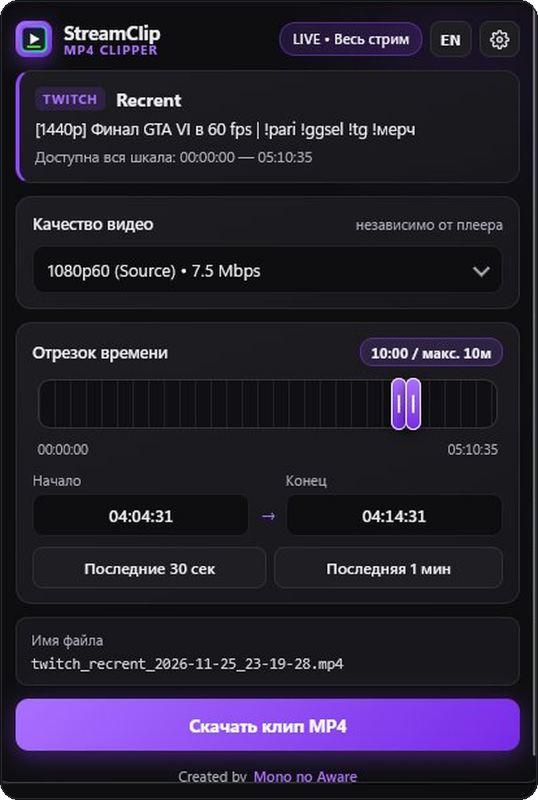
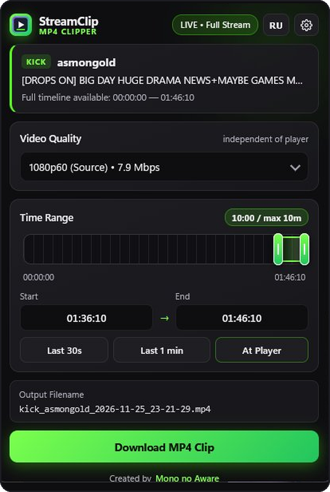
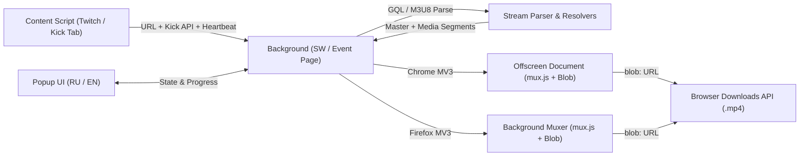

<div align="center">

# StreamClip

**Instant MP4 clipper for Twitch & Kick streams and VODs — right inside Chrome & Firefox.**

**English** | [Русский](README.ru.md)


</div>

---

## Preview

<p align="center">
  
  &nbsp;&nbsp;&nbsp;&nbsp;
  
</p>

---

## Features (MVP)

- **Automatic Mode Detection** — Opening the popup detects whether you are on a recorded VOD (full timeline available) or a live broadcast on Twitch or Kick.
- **Smart Live Rewind** — If the streamer has auto-archive enabled, StreamClip lets you pick any timestamp starting from `00:00:00` of the live broadcast. If auto-archive is disabled, a lightweight background ring buffer keeps the last 2–3 minutes of segment URLs per quality from the moment the tab opened.
- **Range Selection & Quick Presets** — Dual-thumb slider + editable `HH:MM:SS` start/end inputs + one-click **Last 30s** and **Last 1 min** buttons (plus **At Player** on VODs).
- **Independent Quality Picker** — Quality list (`1080p60 (Source)`, `720p60`, `480p`, etc.) is parsed directly from the master `.m3u8` playlist. Watch in 360p and export your clip in 1080p60.
- **Multi-Threaded TS Fetch + Ad Skip + Instant MP4 Remux** — Downloads `.ts` segments concurrently (6 parallel workers), automatically skips Twitch stitched ad blocks (`#EXT-X-DATERANGE` / `#EXT-X-DISCONTINUITY` / `SCTE35`), realigns fragment decode timestamps (`tfdt`) and `moov` durations via `mux.js` in memory with zero re-encoding, and triggers a clean `.mp4` download.
- **Automatic Theme Switching** — Automatically adapts UI colors between Twitch Violet (`#9146FF`) and Kick Neon Green (`#53FC18`).
- **Optional Quick Hotkeys** — Enable in Settings to instantly clip the last 30s (`Alt+Shift+S`) or 60s (`Alt+Shift+D`) without opening the popup.
- **Filename Mask** — Automatically names exported clips as `{platform}_{streamer}_{date}_{time}.mp4` (for example `twitch_shroud_2026-11-25_21-50-00.mp4`).

---

## Architecture (4 Modules)

| Module | Responsibility | Stack | Files |
| :--- | :--- | :--- | :--- |
| **Content Script** | Reads tab URL/player time, handles SPA navigation, runs in-tab Kick API requests (bypassing Cloudflare), keeps MV3 buffer heartbeat alive. | Pure JS | `src/content/content.js` |
| **Stream Parser** | Resolves `.m3u8` playlists via Twitch GQL & Kick REST API, extracts qualities, segment timings, and Twitch ad markers. | Pure JS | `src/core/m3u8-parser.js`, `src/platforms/twitch.js`, `src/platforms/kick.js` |
| **Background / Offscreen** | Maintains per-tab 3-minute ring buffer of segment URLs and orchestrates parallel segment downloads and browser file saving. | Service Worker + Offscreen API (Chrome) / Event Page (Firefox) | `src/background/background.js`, `src/offscreen/offscreen.*` |
| **Muxer + UI** | Remuxes `.ts` bytes into continuous `.mp4` in memory (`mux.js` + ISOBMFF duration/timestamp patching) with bilingual RU/EN popup UI. | `mux.js` + HTML/CSS | `src/core/mp4-muxer.js`, `src/core/clip-builder.js`, `src/popup/*` |



---

## Installation

### Option 1: From GitHub Releases (Recommended)

1. Download the archive for your browser on the [Releases](https://github.com/Mono-no-Awares/StreamClip/releases) page:
   - **Chrome / Edge / Brave**: `streamclip-chrome-v1.0.0.zip`
   - **Firefox**: `streamclip-firefox-v1.0.0.zip`
2. **Chrome / Edge / Brave**:
   - Extract `streamclip-chrome-v1.0.0.zip` into a folder.
   - Open `chrome://extensions` and enable **Developer mode**.
   - Click **Load unpacked** and select the extracted folder.
3. **Firefox**:
   - Open `about:debugging#/runtime/this-firefox`.
   - Click **Load Temporary Add-on…** and select `streamclip-firefox-v1.0.0.zip` directly (or extract it and select `manifest.json`).
   - *(In Firefox Developer Edition / Nightly, you can install `.zip` permanently via `about:addons` if `xpinstall.signatures.required` is set to `false` in `about:config`.)*

### Option 2: From Source (Build)

1. Clone this repository.
2. **Chrome / Edge / Brave**: open `chrome://extensions`, enable **Developer mode**, click **Load unpacked**, and select the repository root folder (or `dist/chrome/` after building).
3. **Firefox**: run `python scripts/build.py` (Python 3.10+, no external packages required), then load `dist/firefox/manifest.json` via `about:debugging#/runtime/this-firefox`.

---

## Build & Verification

```bash
python scripts/generate_icons.py
python scripts/build.py
python scripts/verify.py
```

The build outputs ready-to-distribute directories and `.zip` archives under `dist/`.

---

## Intentional MVP Scope Limits

- **10-minute clip cap (`600s`)**: Keeps full MP4 assembly fast in RAM via `Blob` without requiring disk-streaming writers.
- **No visual editor or chat overlay**: No 9:16 TikTok cropping or emote rendering in v1.0.

---

## Author & License

- Created by **Mono no Aware** — [github.com/Mono-no-Awares](https://github.com/Mono-no-Awares)
- Licensed under the [MIT License](LICENSE).
- Uses [mux.js](https://github.com/videojs/mux.js) (`Apache-2.0`); see [THIRD_PARTY_NOTICES.md](THIRD_PARTY_NOTICES.md).
