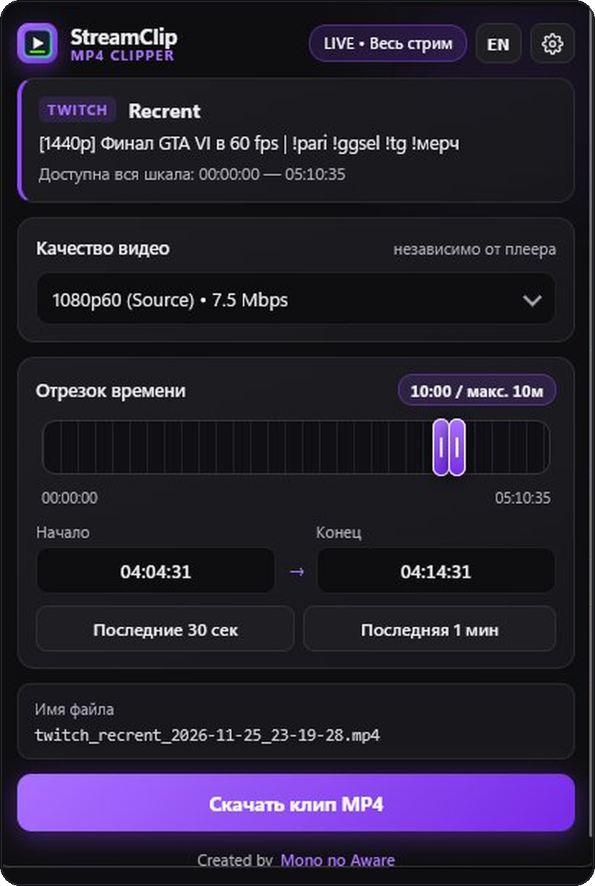
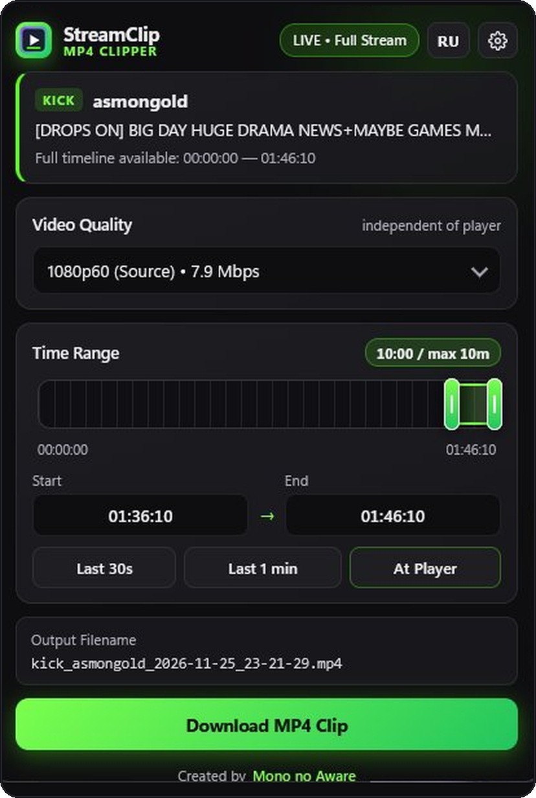
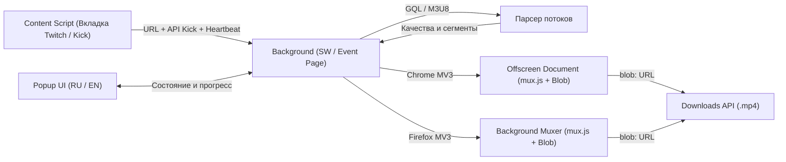

<div align="center">

# StreamClip

**Мгновенная нарезка клипов со стримов и записей Twitch и Kick прямо в MP4 — для Chrome и Firefox.**

[English](README.md) | **Русский**


</div>

---

## Превью

<p align="center">
  
  &nbsp;&nbsp;&nbsp;&nbsp;
  
</p>

---

## Функции MVP

- **Автоопределение режима** — при открытии попапа расширение само определяет, находится ли пользователь на записи стрима (VOD, доступна вся шкала времени) или на прямом эфире (Twitch / Kick).
- **Умный откат на живом эфире** — если у стримера включено автосохранение записи, позволяет выбрать любой момент с самого начала текущего стрима (`00:00:00`). Если запись выключена, держит в памяти лёгкий кольцевой буфер ссылок на последние 2–3 минуты с момента открытия вкладки.
- **Выбор отрезка времени** — двойной ползунок + редактируемые поля `ЧЧ:ММ:СС` (**Начало** — **Конец**) + быстрые кнопки **«Последние 30 сек»**, **«Последняя 1 мин»** (и кнопка **«К плееру»** на VOD).
- **Выбор качества независимо от плеера** — список качеств (`1080p60 (Source)`, `720p60`, `480p` и др.) парсится напрямую из мастер-плейлиста `.m3u8`: можно смотреть стрим в 360p, а клип скачать в 1080p60.
- **Мгновенная склейка в MP4** — скачивание `.ts` сегментов в 6 потоков с прогресс-баром, автоматический пропуск рекламных вставок Twitch (`#EXT-X-DATERANGE` / `#EXT-X-DISCONTINUITY` / `SCTE35`), выравнивание таймингов (`tfdt`) и длительности (`moov`) и переупаковка через `mux.js` в чистый `.mp4` без перекодировки.
- **Адаптивная тема** — интерфейс автоматически переключает цветовую схему между фиолетовым стилем Twitch (`#9146FF`) и неоново-зелёным стилем Kick (`#53FC18`).
- **Горячие клавиши (опционально)** — можно включить в настройках для мгновенного клипа последних 30 сек (`Alt+Shift+S`) или 1 мин (`Alt+Shift+D`) без открытия попапа.
- **Шаблон имени файла** — автоматическое сохранение по маске `{platform}_{streamer}_{date}_{time}.mp4` (например, `twitch_shroud_2026-11-25_21-50-00.mp4`).

---

## Архитектура (4 модуля)

| Модуль | За что отвечает | Инструменты | Файлы |
| :--- | :--- | :--- | :--- |
| **Content Script** | Читает URL/таймкод вкладки, отслеживает SPA-переходы, отправляет запросы к API Kick от лица вкладки (обходя Cloudflare) и держит heartbeat живого буфера. | Чистый JS | `src/content/content.js` |
| **Парсер потоков** | Получает `.m3u8` через GQL-запрос на Twitch и REST API на Kick, разбирает качества, тайминги сегментов и рекламные теги Twitch. | Чистый JS | `src/core/m3u8-parser.js`, `src/platforms/twitch.js`, `src/platforms/kick.js` |
| **Background / Offscreen** | Держит кольцевой буфер ссылок (до 3 минут) на живых стримах без записи и управляет многопоточной загрузкой и сохранением файла. | Service Worker + Offscreen API (Chrome) / Event Page (Firefox) | `src/background/background.js`, `src/offscreen/offscreen.*` |
| **Мультиплексор + UI** | Перекладывает байты из `.ts` в `.mp4` в памяти за доли секунды (с патчем `tfdt` и длительности в `moov`) + двуязычный интерфейс RU/EN. | `mux.js` + HTML/CSS | `src/core/mp4-muxer.js`, `src/core/clip-builder.js`, `src/popup/*` |



---

## Установка

### Вариант 1: Из GitHub Releases (рекомендуется)

1. Скачайте архив для вашего браузера со страницы [Releases](https://github.com/Mono-no-Awares/StreamClip/releases):
   - **Chrome / Edge / Brave**: `streamclip-chrome-v1.0.0.zip`
   - **Firefox**: `streamclip-firefox-v1.0.0.zip`
2. **Chrome / Edge / Brave**:
   - Распакуйте `streamclip-chrome-v1.0.0.zip` в любую папку.
   - Откройте `chrome://extensions` и включите **Режим разработчика**.
   - Нажмите **Загрузить распакованное расширение** и выберите распакованную папку.
3. **Firefox**:
   - Откройте `about:debugging#/runtime/this-firefox`.
   - Нажмите **Загрузить временное дополнение…** и выберите сам архив `streamclip-firefox-v1.0.0.zip` (или распакуйте и укажите `manifest.json`).
   - *(В Firefox Developer Edition / Nightly можно установить архив постоянно через `about:addons`, отключив проверку подписи `xpinstall.signatures.required = false` в `about:config`.)*

### Вариант 2: Из исходников (сборка)

1. Склонируйте репозиторий.
2. **Chrome / Edge / Brave**: откройте `chrome://extensions` → **Режим разработчика** → **Загрузить распакованное расширение** → выберите корневую папку репозитория (или `dist/chrome/` после сборки).
3. **Firefox**: выполните `python scripts/build.py` (нужен только Python 3.10+, без сторонних библиотек) и загрузите `dist/firefox/manifest.json` через `about:debugging#/runtime/this-firefox`.

---

## Сборка и проверка

```bash
python scripts/generate_icons.py
python scripts/build.py
python scripts/verify.py
```

Готовые сборки и `.zip`-архивы сохраняются в папку `dist/`.

---

## Сознательные ограничения MVP

- **Лимит длины клипа до 10 минут (`600с`)** — позволяет быстро собирать файл в оперативной памяти (`Blob`) без сложной потоковой записи на диск.
- **Без визуального редактора и рендера чата** — без обрезки 9:16 под TikTok и наложения смайликов поверх видео в версии `v1.0`.

---

## Автор и лицензия

- Автор: **Mono no Aware** — [github.com/Mono-no-Awares](https://github.com/Mono-no-Awares)
- Распространяется под лицензией [MIT](LICENSE).
- Использует библиотеку [mux.js](https://github.com/videojs/mux.js) (`Apache-2.0`), см. [THIRD_PARTY_NOTICES.md](THIRD_PARTY_NOTICES.md).
